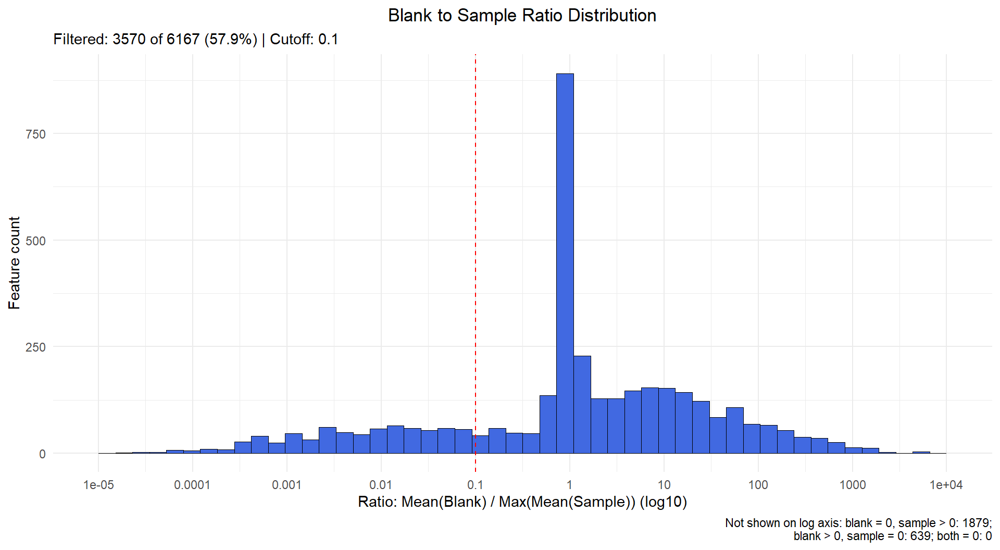
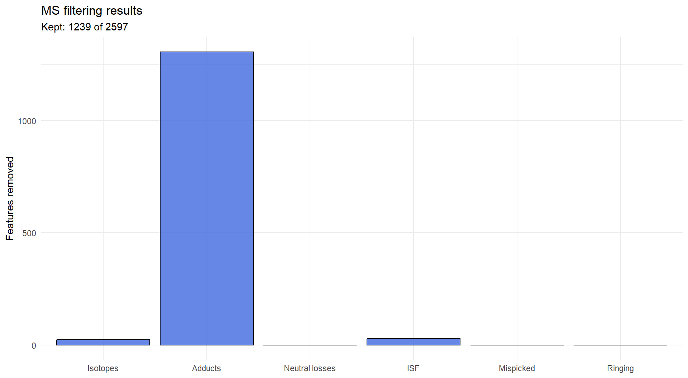
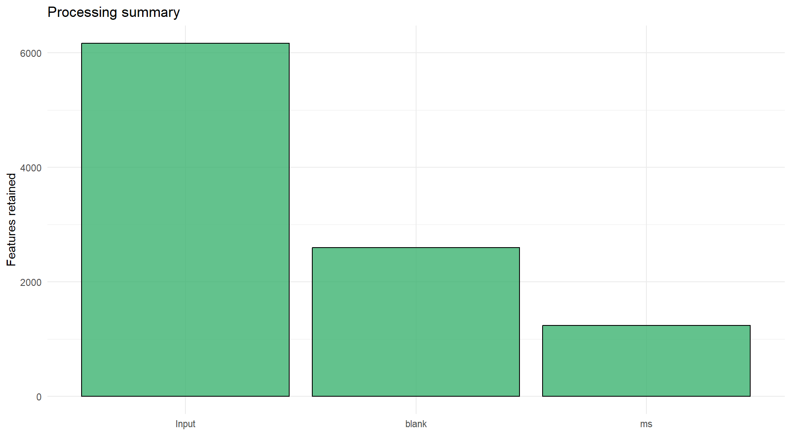

```{r setup, include=FALSE, eval=TRUE}
run_orbi <- identical(tolower(Sys.getenv("METABOCENSOR_RUN_ORBI", "false")), "true")
knitr::opts_chunk$set(eval = run_orbi, collapse = TRUE, comment = "#>",
                      message = FALSE, fig.width = 7, fig.height = 3.8,
                      out.width = "100%", fig.align = "center", dpi = 120)
```

## Overview

This example imports the bundled Orbi peak table, assigns groups from metadata,
removes blank-associated features, and filters isotopes, adducts and in-source
fragments. MGF spectra support the fragment checks. See details about dataset  [here](https://github.com/plyush1993/MetaboCensoR_Examples/tree/main/orbi).

## 1. Import the peak table and groups

The CSV files are installed with the package. There are six blank and three sample columns.

```{r import}
library(MetaboCensoR)
peak_file <- system.file(
  "extdata", "orbi_iimn_gnps_quant.csv",
  package = "MetaboCensoR", mustWork = TRUE
)
imported <- mc_prepare(
  peak_file, type = "mzmine",
  sample_keywords = c(".mzML", "Peak area")
)
metadata_file <- system.file(
  "extdata", "metadata.csv",
  package = "MetaboCensoR", mustWork = TRUE
)
imported$labels <- mc_labels_from_metadata(
  metadata_file, sample_names = imported$sample_cols,
  sample_col = "Sample name", label_col = "Label"
)
```

## 2. Remove blank-associated features

Keep features with mean blank intensity below 10% of the largest biological-group mean. Zero/zero features fail; zero blank with positive sample intensity passes.

```{r blank}
after_blank <- mc_filter_blank(
  imported, groups = "Blank", mode = "mean_cutoff", cutoff = 0.10
)
mc_plot_blank(after_blank, interactive = FALSE)
```


```{r saved-blank, echo=FALSE, eval=!run_orbi}

```

## 3. Apply MS filters

Only the spectra and custom adduct definitions are downloaded. Retention-time tolerances are in minutes; the selected mass tolerances are in Da. The MS2 intensity threshold is 1% of the spectrum base peak.

```{r external-files}
base_url <- paste0(
  "https://raw.githubusercontent.com/plyush1993/",
  "MetaboCensoR_Examples/main/orbi/"
)
mgf_file <- tempfile(fileext = ".mgf")
adduct_file <- tempfile(fileext = ".csv")
download.file(paste0(base_url, "orbi_iimn_gnps.mgf"),
              mgf_file, mode = "wb")
download.file(paste0(base_url, "adducts%20%28nontarget%20%2B%202xH2O%29.csv"),
              adduct_file, mode = "wb")
spectra <- mc_read_mgf(mgf_file)
```


```{r ms}
ms_options <- mc_ms_parameters(
  iso_rt2 = 0.01, iso_cor2 = 0.80,
  iso_tol_type2 = "da", iso_mz_tol2 = 0.005,
  add_rt2 = 0.005, add_cor2 = 0.80,
  add_tol_type2 = "da", add_mz_tol2 = 0.005,
  add_pol2 = "positive",
  isf_rt2 = 0.01, isf_cor2 = 0.95,
  isf_ms2_check2 = TRUE, isf_ms2_mz_tol2 = 0.01,
  isf_ms2_rel2 = 1, isf_mgf_id_field = "acquisitionNum"
)
after_ms <- mc_filter_ms(
  after_blank, filters = c("isotopes", "adducts", "isf"),
  parameters = ms_options, spectra = spectra, adducts = adduct_file
)
mc_plot_ms(after_ms, interactive = FALSE)
```


```{r saved-ms, echo=FALSE, eval=!run_orbi}

```

## 4. Inspect and export

```{r summary}
mc_summary(after_ms)
```


```{r saved-summary, echo=FALSE, eval=!run_orbi, results='asis'}
knitr::kable(data.frame(
  step = c("blank", "ms"), before = c(6167, 2597),
  after = c(2597, 1239), removed = c(3570, 1358)
))
```

The summary plot shows features retained at input, after blank filtering and after MS filtering.

```{r final-summary-plot}
mc_plot_summary(after_ms, interactive = FALSE)
```

```{r saved-final-summary, echo=FALSE, eval=!run_orbi}

```

Annotation tables and removed IDs remain accessible independently of the exported peak table.

```{r annotations, eval=FALSE}
# Inspect annotation tables interactively
head(after_ms$annot_tbls$add_table)
head(after_ms$annot_tbls$isf_table)
```

The export restores the input table layout and keeps MGF spectra matching retained feature IDs. Replace `tempdir()` with your output directory to keep the files permanently.

```{r export}
output <- mc_export(
  after_ms,
  csv = file.path(tempdir(), "orbi_filtered.csv"),
  mgf = spectra,
  mgf_file = file.path(tempdir(), "orbi_filtered.mgf")
)
```

## Alternative: one pipeline call

Starting from the same `imported` object, this replaces the two filtering calls above. Reuse `ms_options`, `spectra` and `adduct_file` already defined. Export `after_run` in the same way as `after_ms`.

```{r pipeline, eval=FALSE}
after_run <- mc_run(
  imported,
  blank = list(groups = "Blank", mode = "mean_cutoff", cutoff = 0.10),
  ms = list(filters = c("isotopes", "adducts", "isf"),
            parameters = ms_options, spectra = spectra, adducts = adduct_file),
  qc = NULL,
  peak = NULL
)
```

